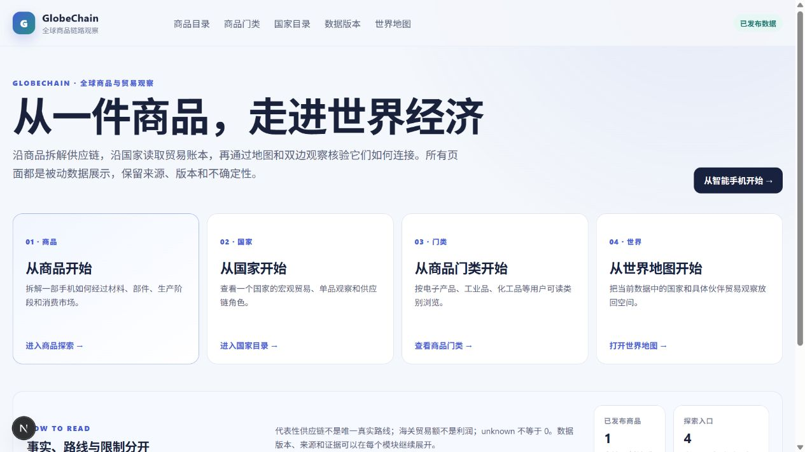

# GlobeChain 阶段成果说明

## 项目定义

GlobeChain 是一个面向普通用户、学生与产业研究者的全球商品供应链和贸易数据可视化平台。项目希望解决的问题是：日常商品背后的材料来源、生产分工和国家贸易关系分散在海关统计、宏观数据库与行业资料中，普通用户很难把这些信息连接成一条可以理解和核验的链路。

首个可交互 Demo 以通用智能手机为入口，把商品拆解、代表性供应链、国家产业角色、双边贸易观察和国家贸易账本连接起来。

## 当前可体验功能

1. 四种探索入口：商品、国家、商品门类和世界节点图。
2. 通用智能手机的商品拆解树与组件层级。
3. 手机电池相关的锂、钴、镍、石墨、铜、铝、材料加工、电芯、模组、组装和消费市场路线。
4. 可点击、可按阶段和组件筛选的供应链路线图。
5. 国家贸易账本，包括宏观进出口、贸易差额、官方储备和智能手机 HS 2022/851713 观察。
6. 国家级世界节点图，以及商品、国家、进口/出口方向筛选。
7. 来源、证据、许可证、数据集版本、内容版本与证据缺口展示。

## 数据与解释边界

- 当前数据期间固定为 2023 年。
- 供应链路线是基于公开来源整理的代表性路线，不代表某一品牌、型号或单台手机的唯一真实路线。
- 国家产业角色证据不自动证明相邻国家间存在确定的双边物流。
- 海关贸易金额不等于企业利润、成本、手机价格或国内增加值。
- `unknown`、未披露、估算值和真实零值分别保存和展示。
- `partnerCode=0` 仅表示世界总计，不作为具体伙伴连线。

## 技术实现

- Web：Next.js、React、TypeScript。
- 架构：模块化单体与 pnpm workspace。
- 数据：不可变 published JSON release，运行时不调用外部 API。
- 契约：Zod 数据模式与只读领域查询层。
- 发布：active manifest、历史版本校验、回滚命令和 CI。
- 当前 active release：`globe-chain-smartphone-2023.10`。

## 当前验证状态

- ESLint：通过。
- TypeScript 类型检查：通过。
- Vitest：22 个测试文件、102 个测试通过。
- Next.js 生产构建：通过。
- 首页、商品页、供应链页面和世界节点图已完成实际视觉检查。

## 阶段截图

### 首页与四种探索入口

### 智能手机商品总览

### 电池供应链路线图

### 世界节点图与贸易方向筛选

## 下一阶段

1. 把 Demo 部署到公开网络，形成评委可访问的 URL。
2. 完成 2 分钟演示视频。
3. 邀请 5—10 名目标用户体验并记录反馈。
4. 优化移动端、导航文案和地图交互。
5. 回到智能手机数据层，补齐更多组件、国家、年份与可验证证据。
