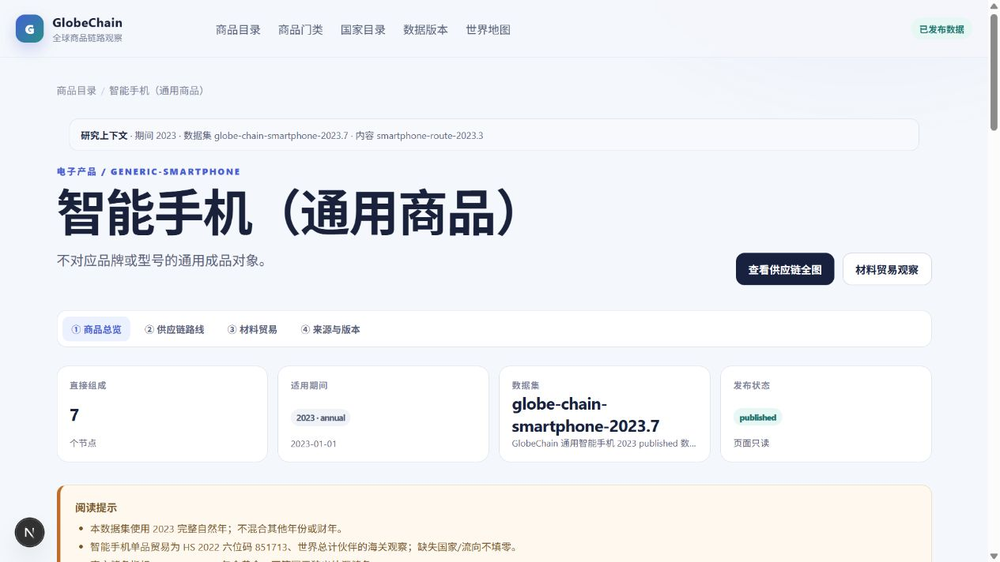
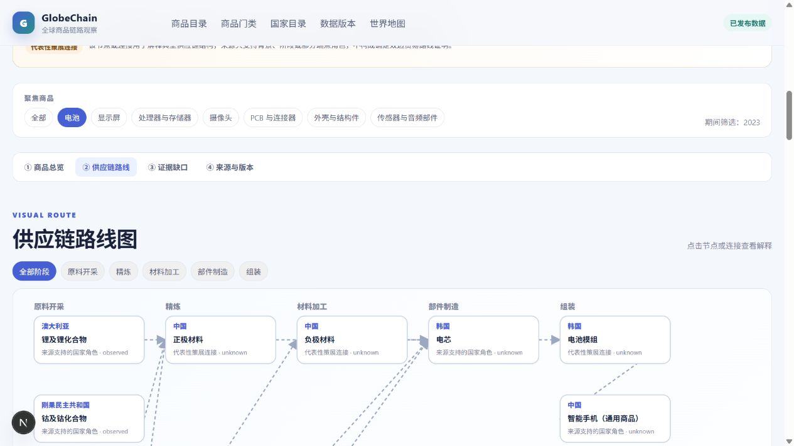
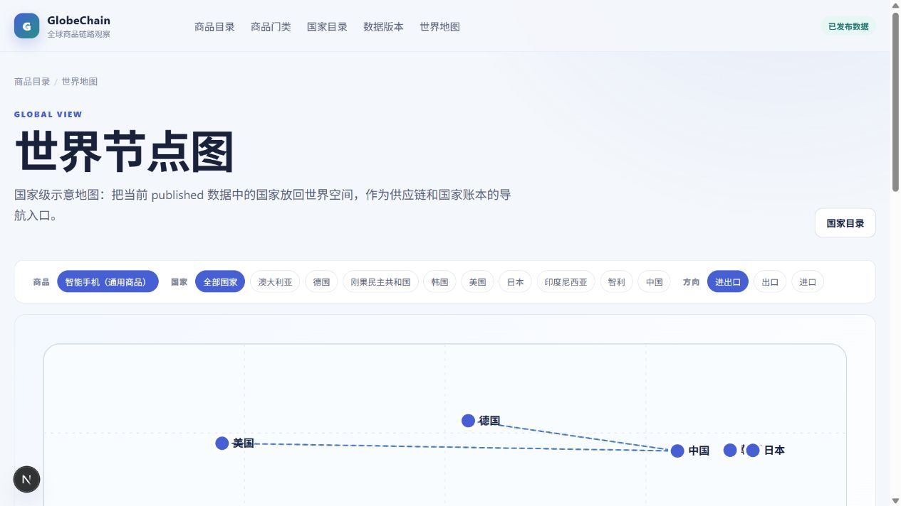

# GlobeChain 阶段成果说明

## 项目定义

GlobeChain 是一个面向跨境采购和外贸调研人员的进出口贸易信息查询与指南针网站。项目希望解决的问题是：商品归类、目的地政策、关税、手续和文件信息分散在不同官方系统与行业资料中，调研人员需要反复切换页面才能形成可执行的核验清单；商品供应链与国家贸易数据则作为背景，帮助用户理解查询结果。

首个可交互 Demo 以通用智能手机为入口，先按国家/地区和进口/出口方向展示贸易指南，再把商品拆解、代表性供应链、国家产业角色、双边贸易观察和国家贸易账本作为可追溯背景连接起来。

## 当前可体验功能

1. 贸易指南工作台：按商品、国家/地区和进口/出口方向查询。
2. 商品、国家、商品门类和世界节点图等背景探索入口。
3. 通用智能手机的商品拆解树与组件层级。
4. 手机电池相关的锂、钴、镍、石墨、铜、铝、材料加工、电芯、模组、组装和消费市场路线。
5. 可点击、可按阶段和组件筛选的供应链路线图。
6. 国家贸易账本，包括宏观进出口、贸易差额、官方储备和智能手机 HS 2022/851713 观察。
7. 国家级世界节点图，以及商品、国家、进口/出口方向筛选。
8. 来源、证据、许可证、数据集版本、内容版本与证据缺口展示。

## 数据与解释边界

- 当前数据期间固定为 2023 年。
- 供应链路线是基于公开来源整理的代表性路线，不代表某一品牌、型号或单台手机的唯一真实路线。
- 国家产业角色证据不自动证明相邻国家间存在确定的双边物流。
- 海关贸易金额不等于企业利润、成本、手机价格或国内增加值。
- `unknown`、未披露、估算值和真实零值分别保存和展示。
- `partnerCode=0` 仅表示世界总计，不作为具体伙伴连线。

## 技术实现

- Web：Next.js、React、TypeScript。
- 架构：模块化单体与 pnpm workspace。
- 数据：不可变 published JSON release，运行时不调用外部 API。
- 契约：Zod 数据模式与只读领域查询层。
- 发布：active manifest、历史版本校验、回滚命令和 CI。
- 当前 active release：`globe-chain-smartphone-2023.16`。

## 当前验证状态

- ESLint：通过。
- TypeScript 类型检查：通过。
- Vitest：25 个测试文件、114 个测试通过（含贸易指南契约与查询测试）。
- Next.js 生产构建：通过。
- 首页、贸易指南、商品页、供应链页面和世界节点图已完成实际视觉检查。

## 阶段截图

### 首页与四种探索入口

### 智能手机商品总览

### 电池供应链路线图

### 世界节点图与贸易方向筛选

## 下一阶段

1. 把 Demo 部署到公开网络，形成评委可访问的 URL。
2. 完成 2 分钟演示视频。
3. 邀请 5—10 名目标用户体验并记录反馈。
4. 优化移动端、导航文案和地图交互。
5. 回到智能手机数据层，补齐更多组件、国家、年份与可验证证据。
